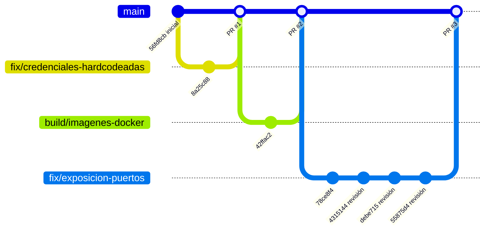
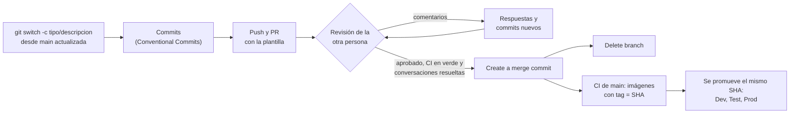

# Estrategia de ramas

Usamos GitHub Flow: `main` siempre desplegable y una rama corta por cambio, que entra por PR revisado. La justificación está en el [ADR 0002](../adr/0002-estrategia-de-ramas.md) y las reglas prácticas en [CONTRIBUTING.md](../../CONTRIBUTING.md).

## Historia real de `main`

Cada PR entra con un merge commit. En el PR #3 se ven también los commits que agregó el revisor durante la revisión.

## Ciclo de vida de una rama

